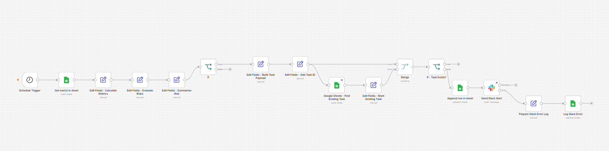
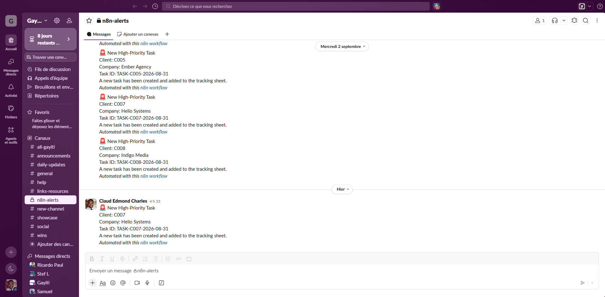
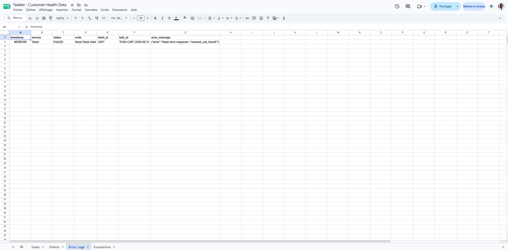

# n8n Customer Health Risk Detection

An n8n workflow that monitors customer health data, detects at-risk customers, creates follow-up tasks, sends Slack alerts, and logs API failures.

## Project Overview

This workflow reads customer data from Google Sheets and evaluates multiple risk indicators:

- Customer inactivity
- Low NPS score
- Support escalation
- Upcoming renewal

When a customer is considered at risk, the workflow creates a follow-up task and checks whether that task already exists before adding it to the tracking sheet.

For newly created high-priority tasks, the workflow sends a notification to Slack.

## Workflow Features

- Scheduled execution with n8n
- Google Sheets integration
- Customer risk calculation
- Conditional routing with IF nodes
- Duplicate task detection
- Dynamic task creation
- Slack API integration
- Explicit API error handling
- Error logging to Google Sheets

## Workflow Logic

```text
Schedule Trigger
      ↓
Read Customers from Google Sheets
      ↓
Calculate Customer Metrics
      ↓
Evaluate Risk Conditions
      ↓
Is Customer At Risk?
      ↓ Yes
Build Task Payload
      ↓
Generate Task ID
      ↓
Check Existing Tasks
      ↓
Task Already Exists?
      ↓ No
Append Task to Google Sheets
      ↓
Send Slack Alert
      ↓ Error
Prepare Slack Error Log
      ↓
Log Slack Error
```

## Local Development with Docker

This repository ships a small Docker Compose setup to run n8n locally on Windows
with Docker Desktop. The instance is bound to `127.0.0.1` only and is never
exposed on the network or the Internet.

### Prerequisites

- Docker Desktop for Windows (running)
- PowerShell
- `docker --version` and `docker compose version` must both answer

### 1. Create your local `.env`

```powershell
Copy-Item .env.example .env
```

Then open `.env` and set `N8N_ENCRYPTION_KEY` to a long random value, for example:

```powershell
[Convert]::ToBase64String((1..48 | ForEach-Object { Get-Random -Max 256 }))
```

`.env` is git-ignored and must **never** be committed. Keep the encryption key
safe: if you lose it, every credential stored in n8n becomes unreadable.

### 2. Start n8n

```powershell
.\scripts\start-n8n.ps1
# or directly:
docker compose up -d
```

The editor is then available at **http://localhost:5678**.

On the very first start, create your local owner account in that interface.

### 3. Stop n8n

```powershell
.\scripts\stop-n8n.ps1
# or directly:
docker compose down
```

`docker compose down` stops the container but **keeps your data**.
Never run `docker compose down -v` unless you really want to wipe the
instance: `-v` deletes the persistent volume.

### 4. Logs and status

```powershell
.\scripts\logs-n8n.ps1            # last 100 lines
.\scripts\logs-n8n.ps1 -Follow    # live tail
.\scripts\status-n8n.ps1          # container + volume state
```

### 5. Where the data lives

All persistent state is stored in the Docker named volume `n8n_data`, mounted at
`/home/node/.n8n` inside the container. It holds:

- the n8n SQLite database
- the workflows created or imported in the instance
- the encrypted credentials
- the instance settings and local metadata

This project uses SQLite (the n8n default); no PostgreSQL is required.

### 6. Import the workflow

The `./workflow` folder is mounted read-only at `/workflow` inside the container.

Import it **after** creating your owner account:

```powershell
.\scripts\import-workflow.ps1
# or directly:
docker compose exec n8n n8n import:workflow --input=/workflow/customer-health-risk-detection.json
```

The workflow is shipped with `"active": false`, so it will not run on import.

### 7. After the import: manual configuration

The JSON contains **no credentials**. You must configure the following by hand in
the n8n interface:

- create the **Google Sheets** credential and attach it to the Google Sheets nodes
- create the **Slack** credential and attach it to the Slack node
- replace `YOUR_GOOGLE_SHEET_ID` with your real spreadsheet ID
- replace `YOUR_SLACK_CHANNEL_ID` with your real Slack channel ID

### Security notes

- Never commit `.env`
- Never commit Google OAuth secrets, Slack tokens or API keys
- Credentials belong in the n8n credential store, not in this repository

## Web application

The responsive Next.js application makes the workflow usable by a Customer
Success Manager without opening n8n.

**Live application:** https://n8n-customer-health-risk-detection.vercel.app/

> Status verified on 24 October 2026: the public URL loads, but it still serves
> an earlier UI and `/api/analyze` reports that `N8N_WEBHOOK_URL` is not
> configured. Complete the [deployment checklist](#deployment-checklist) before
> Demo Day.

### Problem and target users

Customer-success teams often inspect usage, NPS, support escalations, and
renewal dates manually. That makes detection slow and inconsistent. This
prototype gives Customer Success Managers and CS Operations teams one
repeatable, evidence-backed assessment and one concrete next action.

### User flow

1. A user selects a demo customer.
2. The frontend sends `client_id` to `/api/analyze`.
3. The server-side route validates the request and forwards it to n8n.
4. n8n reads the customer from Google Sheets and calculates deterministic risk flags.
5. Specialized Gemini agents classify risk, extract evidence, and recommend a follow-up.
6. n8n returns a structured JSON response.
7. The API validates the response contract before the UI renders it.

The interface never presents a mocked response as a live analysis. Missing
configuration and upstream failures are shown as visible error states.

### Technology stack

- Next.js 16, React 19, TypeScript, and Tailwind CSS 4
- n8n for orchestration
- Gemini models connected to n8n AI Agent nodes
- Google Sheets for `Clients`, `Tasks`, and `Error Logs`
- Slack for optional notifications
- Docker Compose for local n8n
- Vercel for frontend hosting

### Architecture

```mermaid
flowchart LR
    U[Customer Success user] --> UI[Next.js web application]
    UI --> API[POST /api/analyze]
    API --> WH[n8n Webhook\ncustomer-risk-analysis]
    WH --> GS[(Google Sheets\nClients)]
    GS --> RULES[Deterministic metrics\nand risk flags]
    RULES --> CLASSIFIER[Risk Classifier Agent]
    RULES --> EXTRACTOR[Signal Extractor Agent]
    CLASSIFIER --> MERGE[Merge agent analysis]
    EXTRACTOR --> MERGE
    MERGE --> REASONER[Action Reasoner Agent]
    REASONER --> RESPONSE[Structured JSON response]
    RESPONSE --> API
    API --> UI
    REASONER -. optional task path .-> TASKS[(Google Sheets\nTasks)]
    TASKS -. optional notification .-> SLACK[Slack]
    SLACK -. failure log .-> ERRORS[(Google Sheets\nError Logs)]
```



### Multi-agent responsibilities

- **Risk Classifier:** assigns level, category, and confidence.
- **Risk Signal Extractor:** reports only facts supported by the supplied metrics.
- **Action Reasoner:** chooses priority and a concrete follow-up without re-scoring.
- **Slack Composer:** formats an already-approved decision.

Structured Output Parser nodes constrain each agent response.

### Repository structure

```text
frontend/                     Next.js application and API route
workflow/                     n8n import templates
sample-data/                  Safe example customer data
scripts/                      n8n lifecycle and sanitization helpers
docs/                         Screenshots and M5 documentation
compose.yaml                  Local n8n service
```

### Screenshots







### Run the frontend locally

```powershell
Set-Location frontend
Copy-Item .env.example .env.local
npm ci
npm run dev
```

Open http://localhost:3000.

### Import the Webhook workflow

Import `workflow/customer-health-risk-detection-web-app.json`. This sanitized
37-node template is inactive and contains no credential or real resource ID.
Configure:

- the Google Sheets credential and `YOUR_GOOGLE_SHEET_ID`;
- the `Clients`, `Tasks`, and `Error Logs` worksheets;
- Gemini credentials on the four model nodes;
- the Slack credential and `YOUR_SLACK_CHANNEL_ID` only after reconnecting and
  testing the optional notification path.

In the verified 37-node export, the Webhook analysis path returns the frontend
response, while the retained Tasks/Slack branch is not connected to that path.
Do not present Slack as part of a Web analysis until that branch is deliberately
rewired and tested in a duplicate workflow.

Publish only after testing. The production endpoint must end with
`/webhook/customer-risk-analysis`.

### Frontend environment

`frontend/.env.local` and Vercel require two server-only variables:

```dotenv
N8N_WEBHOOK_URL=https://n8n.example.com/webhook/customer-risk-analysis
N8N_WEBHOOK_SECRET=<same value as the n8n Header Auth credential>
```

A Vercel deployment cannot reach `localhost`. Do not prefix either variable
with `NEXT_PUBLIC_`. See [the Railway deployment guide](docs/RAILWAY_DEPLOYMENT.md)
for the prepared n8n hosting configuration.

### API contract

Request:

```json
{ "client_id": "C005" }
```

Successful response:

```json
{
  "success": true,
  "customer": {
    "id": "C005",
    "name": "Ember Agency",
    "riskLevel": "HIGH",
    "riskCategory": "ENGAGEMENT_RISK",
    "riskSignals": ["no login for 62 days"],
    "priority": "HIGH",
    "recommendedAction": "Contact the customer about the drop in usage.",
    "taskStatus": "RISK_DETECTED"
  }
}
```

The API rejects missing or unknown demo IDs, handles timeouts and non-JSON
responses, and validates the complete n8n response before returning it.

### Testing

```powershell
Set-Location frontend
npm run lint
npm test
npm run build
```

Automated tests are described in
[Testing & Production Hardening (M6)](#testing--production-hardening-m6).

Manual checks:

1. Submit `/analyze` with no selection and verify the visible error state.
2. Select C005, C006, or C008 and run an analysis against an active test Webhook.
3. Verify every response field and the browser console.
4. Repeat near a 390 px mobile viewport.

### Deployment checklist

1. Commit and push the intended frontend and documentation files.
2. Set the Vercel Root Directory to `frontend`.
3. Add `N8N_WEBHOOK_URL` and `N8N_WEBHOOK_SECRET` to Preview and Production.
4. Deploy n8n on Railway with its persistent volume, import the Web App export,
   attach the matching Header Auth credential, then publish the workflow.
5. Redeploy Vercel.
6. Run one controlled demo-customer analysis with test-only destinations.

### Known limitations

- The public deployment currently lacks the n8n URL/secret configuration and
  serves an older revision.
- The verified local n8n Web App workflow is inactive.
- The retained Tasks/Slack branch is disconnected from the Webhook path and is
  not verified for Web executions.
- The demo customer catalog is static.
- Google Sheets task deduplication is not atomic under concurrent requests.
- Gemini availability and latency affect the 120-second request window.
- A failure after an external action but before logging can require reconciliation.

### Next steps

- Configure the public n8n URL and Vercel environment variable.
- Deploy the current frontend revision.
- Record one controlled successful run as the Demo Day fallback.
- Add automated browser tests after the public integration is stable.

## Testing & Production Hardening (M6)

### Objectives

During M5, the application failed in production in several ways: expired
Google OAuth credentials, HTTP 500/502/504 responses, a dropped SSH tunnel and
a broken frontend build. Each one was found by hand. The M6 test suite makes
the critical path (customer selection → `/api/analyze` → n8n → validated
result) verifiable in seconds and checks it automatically on every pull
request.

### Framework

- [Vitest](https://vitest.dev/) 4 in a Node environment, with V8 coverage
  (`@vitest/coverage-v8`).
- No browser, Docker or mock server is used. The n8n Webhook is replaced by a
  stubbed `fetch` in unit/API tests.

### Two kinds of tests

| | Unit/API tests | Live integration test |
| --- | --- | --- |
| Files | `src/**/*.test.ts` | `src/**/*.integration.test.ts` |
| Command | `npm test` / `npm run test:coverage` | `npm run test:integration` |
| n8n / Google Sheets / Gemini | **Mocked**; nothing external is called | **Real**; nothing is mocked |
| Secrets required | None | `N8N_WEBHOOK_URL`, `N8N_WEBHOOK_SECRET` |
| Runs in CI | Yes | **No**, it is run manually only |

The mocked tests prove how the API route behaves. They do not prove that the
live workflow works; only the integration test does.

### Critical paths covered

- **API request validation**: invalid JSON, missing, empty or non-string
  `client_id`, and unknown customer IDs (n8n is never called).
- **Configuration**: missing or blank `N8N_WEBHOOK_URL` / `N8N_WEBHOOK_SECRET`
  returns `500 N8N_WEBHOOK_NOT_CONFIGURED`.
- **n8n call**: correct URL, `X-N8N-Webhook-Secret` header, trimmed ID,
  `no-store` and a timeout signal.
- **Response contract**: a valid analysis passes through unchanged, and
  incomplete or malformed payloads return `502 N8N_INVALID_CONTRACT`.
- **Upstream failures**: non-JSON or HTML error pages (`502
  N8N_INVALID_RESPONSE`), n8n HTTP 403/404/500 (`N8N_REQUEST_FAILED`),
  timeouts (`504`), network failures such as a dropped tunnel (`502
  N8N_UNREACHABLE`) and unexpected errors (`500 INTERNAL_ERROR`).
- **Security**: the webhook secret never appears in responses or logs.
- **Data transformations**: demo customer lookup (`getCustomer`), mapping of
  AI risk and priority values to display tones (`getTone`), and navigation
  matching.
- **Live** (manual): the n8n Webhook rejects unauthenticated calls, and C005 is
  analyzed end-to-end through the Webhook and through `/api/analyze`. The
  assertions check structure and business rules, not Gemini's exact wording.

### Run the tests locally

```powershell
Set-Location frontend
npm ci
npm test                  # mocked unit/API tests
npm run test:coverage     # same tests + V8 coverage (frontend/coverage/index.html)
npm run test:watch        # watch mode during development
```

### Run the live n8n integration test

Prerequisites: the local n8n stack is running (`.\scripts\start-n8n.ps1` from
the repository root), the
`Customer Health - Web App MVP` workflow is active, and its Google Sheets and
Gemini credentials are valid.

Set these variables in `frontend/.env.local` (gitignored) or in the shell:

- `N8N_WEBHOOK_URL`: prefer the local URL,
  `http://localhost:5678/webhook/customer-risk-analysis`
- `N8N_WEBHOOK_SECRET`: the value of the n8n Header Auth credential

```powershell
Set-Location frontend
npm run test:integration
```

The test sends real requests for customer `C005`, which use Gemini quota. The
verified run took 17.31 s, but Gemini latency varies, so each test allows up to
180 s. The Web App Webhook path only reads Google Sheets and
returns the analysis: it creates no task and sends no Slack message. If a
variable is missing, the test fails with an explicit "not configured" error
instead of being skipped.

The public deployment (Vercel → VPS Nginx → reverse SSH tunnel → local n8n)
depends on that local machine and tunnel being up, so the live test is a
manual check, not a CI gate.

### Continuous integration

[`.github/workflows/tests.yml`](.github/workflows/tests.yml) runs on pushes to
`main` and on pull requests. It uses Node.js 24 and runs `npm ci`, then
`npm run lint`, then `npm run test:coverage` in `frontend/`. The HTML coverage
report is uploaded as the `coverage-report` artifact. The workflow needs no
secrets and never runs the live integration test. The production build is still
run by Vercel on deploy.

CI passed on [pull request #2](https://github.com/EdmondCharles1/n8n-customer-health-risk-detection/pull/2)
(56 tests passed), and the PR was merged into `main` on 2026-10-30. The push
run on `main` after the merge also passed.

### Test results

| Suite | Where it ran | Result |
| --- | --- | --- |
| Unit/API tests (mocked) | Locally and in GitHub Actions CI | 56 passed, 0 failed, 0 skipped |
| Live integration tests (real n8n, Google Sheets and Gemini) | **Locally only**, run manually; not in CI | 3 passed, 0 failed (17.31 s) |

The 3 live tests are: the Webhook rejects an unauthenticated request; C005 is
analyzed through the n8n Webhook; and C005 is analyzed through the Next.js
`/api/analyze` route.

### Coverage results

Measured from the mocked unit/API suite (`npm run test:coverage`); the live
tests are not included in the coverage figures:

| Statements | Branches | Functions | Lines |
| --- | --- | --- | --- |
| 95.38% | 90.47% | 90.90% | 95.31% |

**Scope:** `src/app/api/**`, `src/lib/**` and `src/components/RiskBadge.tsx`
only. React pages and the other UI components are not measured, so this is
not whole-application coverage. Per-file figures, the mutation check and the
live test result are in the
[M6 test report](docs/test-results/M6_TEST_REPORT.md).

### Known limitations

- The live tests are run manually and their result reflects one point in time.
  A later failure of OAuth, Gemini or the tunnel would only be detected by
  running them again.
- The public deployment depends on n8n running on a local machine reached
  through a reverse SSH tunnel from the VPS. If either is down, the live app
  and the live tests fail.
- CI checks only the mocked suite. A pull request that breaks the real n8n or
  Gemini contract would still pass CI until the live test is run manually.
- React components and pages have no automated rendering or browser tests.
- The live test depends on local n8n, valid Google OAuth credentials and
  Gemini availability, and it is not run in CI.
- The tests do not cover the n8n workflow's internal logic (risk rules and
  agent prompts); they validate its HTTP contract.
- The mocked contract is hand-written from a verified response. If the
  workflow's output changes, only the live test will detect it.

See [M6 testing submission](docs/M6_TESTING_SUBMISSION.md) for the path
justification and reflection.

## M5 handoff and Demo Day artifacts

- [Technical handoff](docs/TECHNICAL_HANDOFF.md)
- [Demo Day script](docs/DEMO_DAY_SCRIPT.md)
- [Loom recording guide](docs/LOOM_RECORDING_GUIDE.md)
